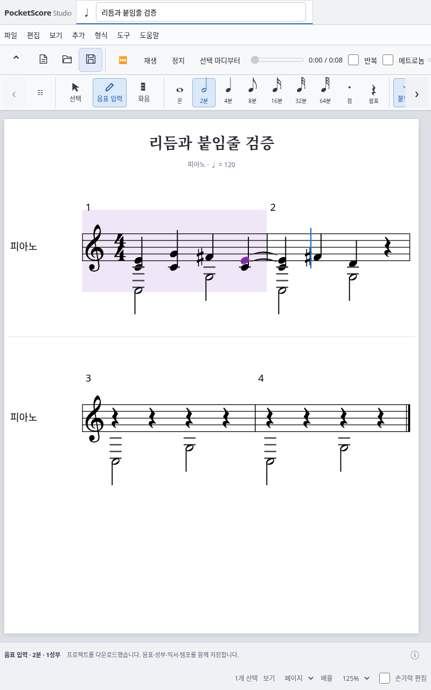

# 자동 붙임줄 입력

기준: main `25a3b40` (리듬·붙임줄 PR #13 병합), 브랜치 `feat/automatic-tied-input`.

## 변경된 동작

- 음표 입력 모드에서 요청 길이가 마디 끝을 넘으면 마디마다 나누고 같은 음높이를 자동 붙임줄로 연결한다. 예: 4/4 마지막 박에 2분음표를 입력하면 현재 마디의 4분음표와 다음 마디의 4분음표가 연결된다.
- 3/8 마지막 8분 위치에서 온음표를 입력하면 `1/8 + 3/8 + 3/8 + 1/8`로 네 마디에 걸쳐 연결된다. 부족한 뒤 마디는 모든 악기·오선지·성부에 쉼표로 추가한다. 입력 커서는 요청한 전체 길이 뒤로 이동한다.
- 새 분할 입력 직후 화음 도구로 구성음을 추가하면 자동 생성된 모든 조각에 그 음을 추가하고 연결한다. 화면 도구·마우스·펜과 기존 Shift+음이름이 같은 명령을 쓴다. 입력 모드를 다시 시작하거나 분할 조각 사이의 연결을 끊으면 이 임시 입력 묶음은 해제된다. 기존 음표를 골라 화음을 추가하는 기능은 선택한 이벤트를 대상으로 유지한다.
- 쉼표 입력도 마디 경계에서 분할하지만 붙임줄과 소리는 생성하지 않는다.
- 새 입력과 붙여넣기는 해당 성부의 대상 시간만 덮는다. 구간 밖에 남는 기존 음은 여러 표기 조각이 필요해도 분할·연결해 실제 음높이와 지속 시간을 보존한다. 덮어쓴 구간을 가로지르는 옛 연결은 끊고, 앞쪽 잔여 음의 기존 입력 연결과 뒤쪽 잔여 음의 출력 연결은 유지한다. 같은 음높이를 새로 입력해도 옛 연결을 임의로 다시 잇지 않는다.
- 복사한 화음이 대상 마디선을 넘으면 모든 구성음을 내부적으로 연결한다. 복사 원본에서 일부 구성음만 다음 화음으로 연결되어 있다면 그 부분 연결은 마지막 조각에서 유지한다. 성부의 아래 행 매핑·초과 행 건너뛰기, 빈 시간의 쉼표, 덮어쓰기와 마디 추가 규칙은 유지한다.
- 한 입력 또는 붙여넣기와 그로 인해 추가된 모든 마디는 한 번의 Undo/Redo로 복구한다. 현재 믹서·마스터 볼륨은 악보 Undo/Redo와 분리한다. 그룹의 모든 길이 변경 금지 규칙은 유지한다.
- 마디를 넘는 미리보기도 지원 범위에서는 정상 색상으로 표시한다. 입력은 포인터를 뗄 때 확정하고 이동·취소 시 악보를 바꾸지 않는다. 하단 입력 패널은 추가하지 않는다.

## 공통 편집 구조와 데이터 보존

`src/project/rhythmEdit.ts`의 `overwriteRhythm`을 음표 입력과 클립보드가 함께 사용한다. 모든 시작·길이·경계는 기존 기약분수 계산을 사용하며 SVG·VexFlow·오디오 객체를 참조하지 않는다. 마디 안의 표기는 지원 길이를 큰 순서로 조합한다. MuseScore의 모든 박자군별 재표기 최적화를 구현한 것은 아니다.

붙임줄은 기존 canonical `tieTo` MIDI 목록을 쓴다. 새 저장 필드나 MusicXML 확장 태그를 추가하지 않는다. 자동 입력의 `NoteEntry.segments`는 입력 커서와 마찬가지로 임시 편집 상태이며 악보 JSON에 저장하지 않는다.

잔여 음의 첫 조각은 원래 ID를 유지해 기존 입력 연결을 보존한다. 끝 조각은 기존 출력 연결을 보존한다. 옛 끝점을 먼저 정리한 뒤 의도적으로 만든 내부 연결을 확정한다. 이 결과를 원본과 다시 정리하면 원래 ID에 새로 생긴 올바른 내부 연결까지 삭제될 수 있으므로 호출자는 이중 정리를 하지 않는다. 잘못된 새 붙임줄이나 파일 데이터는 성공으로 정리하지 않고 기존 모델 검증에서 거부한다.

MuseScore Studio 4.7.5의 [Score::setNoteRest](https://github.com/musescore/MuseScore/blob/3654226c2e99289916916953a98e585a3d3b315a/src/engraving/editing/cmd.cpp#L1087)에서 마디별 gap, duration list, 조각 간 tie 생성을 확인했다. 이 구조를 참고해 기존 TypeScript 모델에 구현했으며 Qt/C++ 엔진을 실행하거나 소스 코드를 복사하지 않았다.

## 재생 위치 이동 수정

추가한 실제 PCM 테스트의 첫 실행에서 31.2초로 이동한 직후 0.25초로 다시 이동하는 실패를 발견했다. AudioWorklet은 비동기로 위치 이동을 확인하지만 기존 `Player.emit()`은 요청 직후 이전 시퀀서 시간을 다시 화면에 보고했다. 그 결과 제어된 슬라이더 값이 돌아가고 마지막 change 이벤트가 옛 값으로 두 번째 seek를 보냈다.

`pendingSeek`가 최신 요청 위치를 유지하고 일치하는 `timeChange` 응답 이후에만 엔진 시계를 다시 읽는다. 이전 응답은 최신 요청을 해제하지 않으며, 응답 전 일시정지도 요청 위치를 보존한다. 최신 요청 전에 발생한 응답을 지연해 전달하는 결정적 회귀 테스트와 수정 후 실제 PCM 검증을 함께 추가했다. 테스트를 재시도나 skip으로 숨기지 않았다.

## 검증

로컬 환경: Node 24.19.0 / npm 11.9.0, Chromium 154 (`/usr/bin/chromium`), Playwright 1.64.1.

| 검사 | 결과 |
|---|---|
| 타입 검사·ESLint·프로덕션 빌드 | 통과 |
| actionlint·잠금 파일 일치·기존 CI/WASM 계약 검사 | 통과, 계약 테스트 35개 |
| 전체 단위 테스트 | 328개 통과, 실패/skip 0 |
| Chromium | 전체 119개 실행 + 추가한 화면 화음 시나리오 1개 별도 실행 통과, 실패/skip/flaky 0 |
| 실제 SF3 PCM 통합 | 전체 6개 통과, 실패/skip/flaky 0 |
| MusicXML 4.0 XSD | 실제 자동 분할 화음 내보내기 통과 |

Chromium 전체 실행은 오디오 위치 이동 수정 전이며 오디오 수정은 지연 응답 단위 테스트와 전체 PCM 6개로 다시 검증했다. GitHub에서는 최종 커밋의 모든 120개 브라우저 시나리오를 다시 실행한다. [이 브랜치의 Validate 실행 목록](https://github.com/ju87-super/PocketScore/actions/workflows/ci.yml?query=branch%3Afeat%2Fautomatic-tied-input)에서 커밋별 결과와 아티팩트를 확인할 수 있다.

로컬 보고서: `reports/automatic-ties-unit.json`, `reports/quality`, `reports/browser`, `reports/automatic-pointer`, `reports/audio`. 기존 734.45 kB 공유 chunk 경고는 남아 있으며 빌드는 성공했다. 의존성과 잠금 파일은 변경하지 않았다.

- 7개 지원 박자, 모든 64분 격자 시작(마디 끝 포함) × 12개 입력 길이: 총 4,692개 조합에서 한 지속음과 정확한 마디 합계 확인. 이는 박자별 7개 단위 테스트 안의 조합 검증이다.
- 다중 마디·화음·쉼표·임시표 초기화·기존 연결의 앞뒤 조각·동음 재입력·부분 화음 연결·다른 박자로 붙여넣기·여러 행·초과 행·동결 입력 불변성·128마디와 16,000이벤트 초과 거부.
- 독립 MIDI 바이트 해석으로 템포 변경을 거치는 자동 화음의 각 구성음이 한 번의 Note On/Off만 갖는지 확인.
- 실제 Chromium에서 키보드·화면 도구·펜 에뮬레이션, 포인터 확정/취소, 화음 추가 후 다음 입력 위치, 붙여넣기·Undo/Redo·저장/재열기, 390/800px 줄바꿈과 SVG 범위 검사.
- 실제 SF3 합성 PCM에서 자동 입력 지속음이 마디 경계 뒤에도 출력되고 정지 후 무음인지 확인. 결정적 시간 계산은 위 단위 테스트에서 분리한다.
- 실제 자동 분할 화음의 exporter 출력 `.cache/automatic-tie-input.musicxml`을 공식 MusicXML 4.0 XSD로 오프라인 검증했다. JSON과 MusicXML 왕복의 표기·지속 시간도 검사한다.

## 남은 범위

- 연음표, 점64분·점온음표, 겹점, 다른 성부/오선 간 붙임줄과 타악기 붙임줄은 지원하지 않는다. 타악기에서 자동 분할로 붙임줄이 필요한 입력은 원본을 유지하고 이유를 안내한다.
- 기존 연결된 이벤트의 길이 변경과 마디 경계 붙임줄이 있는 악보의 박자 변경은 여전히 먼저 연결을 해제해야 한다. 이번 작업은 새 입력과 붙여넣기의 자동 분할이다.
- 자동 화음 묶음은 새 입력 직후의 임시 상태다. 저장·재열기 후 기존 화음에 추가할 때는 선택한 이벤트만 편집한다.
- 최대 128마디, 16,000이벤트, C2–C7, 서로 다른 화음 8음과 기존 파일 한도를 유지한다.
- 실제 Galaxy Tab/S Pen, 사람의 청음, MuseScore GUI/WASM 검증은 수행하지 않았다. main 병합·Pages 배포·저장소 설정 변경은 실행하지 않는다. PR은 사용자가 생성한다.

